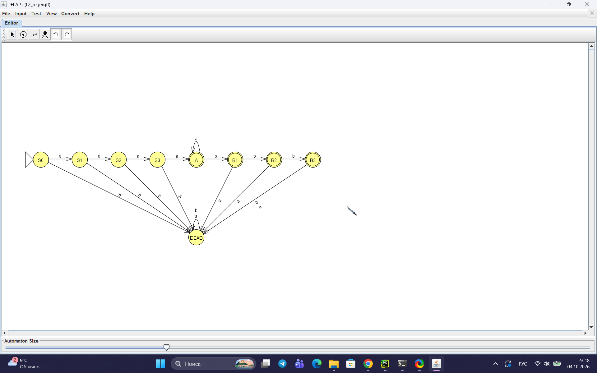
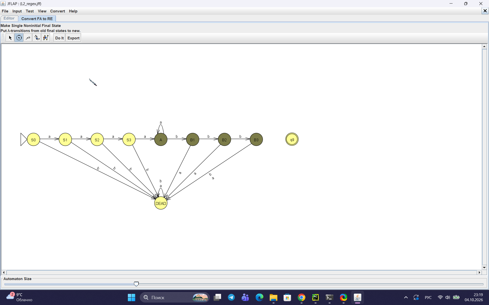
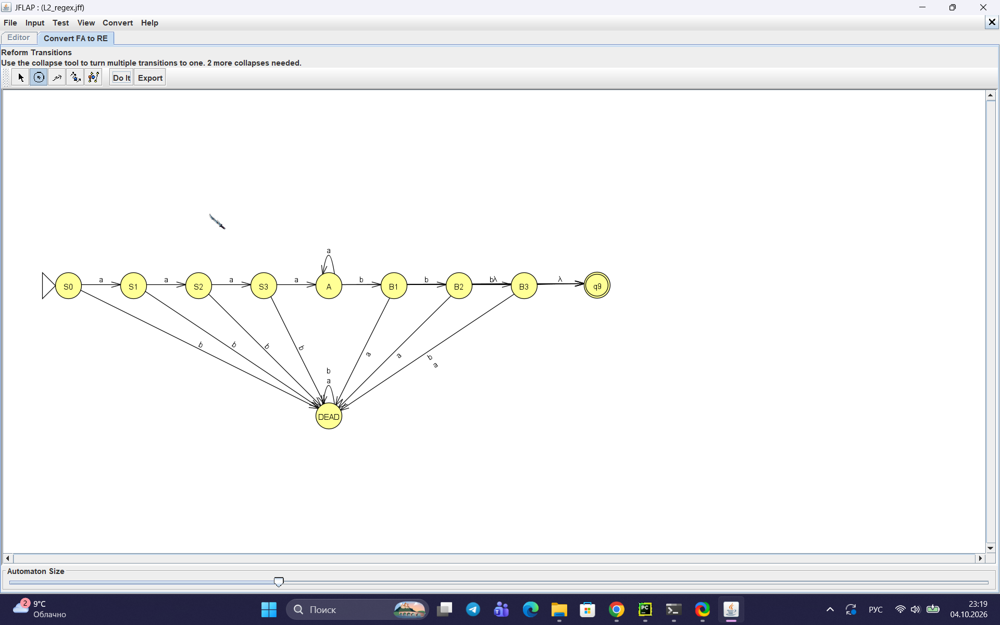
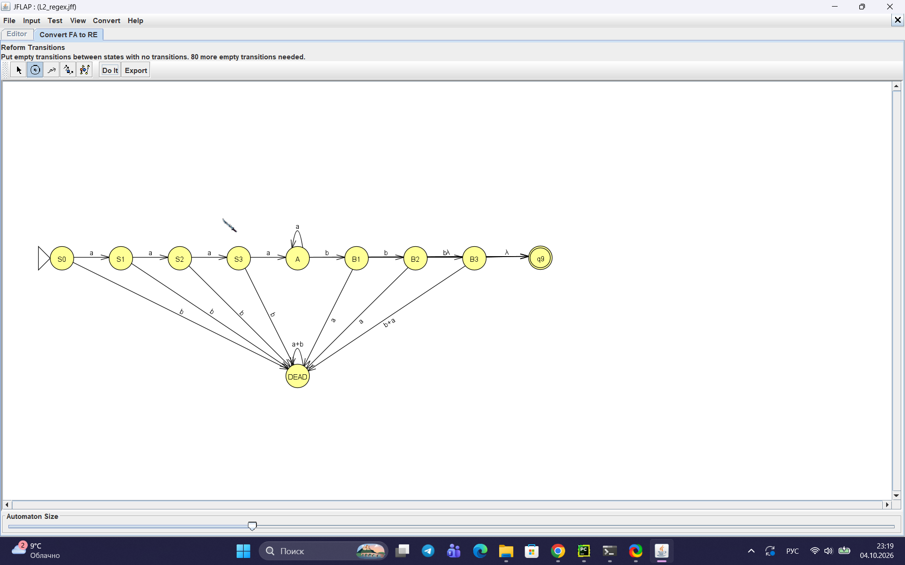
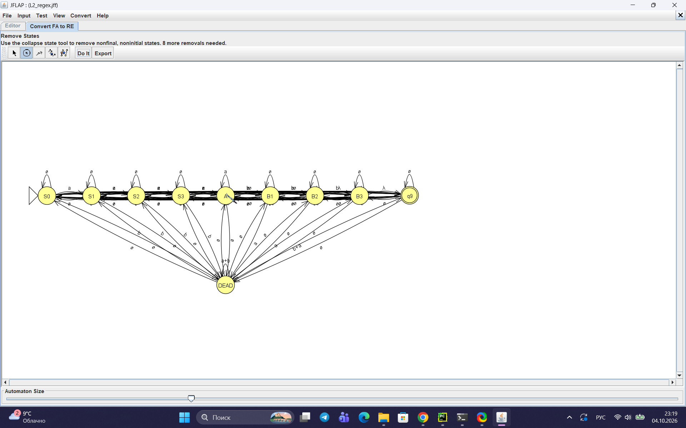
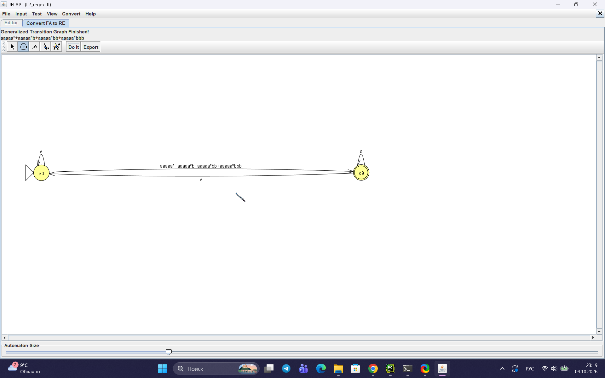

Министерство науки и высшего образования РФ

Федеральное государственное автономное образовательное учреждение высшего образования

**«СИБИРСКИЙ ФЕДЕРАЛЬНЫЙ УНИВЕРСИТЕТ»**

Институт космических и информационных технологий
Кафедра программной инженерии

---

# ОТЧЁТ №2

### По практической работе на тему «Регулярные выражения, грамматики и языки»

*(Теория автоматов, языков и вычислений)*

---

Преподаватель: А. С. Кузнецов

Студент: Шишко Д.Д, гр. КИ24-16/1Б

Красноярск 2026

<!-- pagebreak -->

## 1 Цель работы и постановка задачи

**Цель работы** — изучить регулярные выражения, регулярные грамматики и свойства регулярных языков, а также освоить доказательство нерегулярности языков с помощью леммы о разрастании.

**Вариант задания — № 2.**

> **Часть 1 и 2.** Язык `L2 = {a^n b^m : n ≥ 4, m ≤ 3}`.
>
> **Часть 3.** Язык `L28 = {a^n b^l a^k : k ≠ n + l}`.

**Постановка задачи:**

1. Построить в JFLAP регулярное выражение для языка `L2` (или доказать невозможность).
2. Построить в JFLAP регулярную грамматику для языка `L2` (или доказать невозможность).
3. Доказать формально непринадлежность языка `L28` классу регулярных языков с помощью леммы о разрастании.

---

## 2 Часть 1. Регулярное выражение для L2

### 2.1 Анализ языка

Язык `L2 = {a^n b^m : n ≥ 4, m ≤ 3}` состоит из цепочек, в которых:
- сначала идёт **не менее 4** символов `a`,
- затем — **не более 3** символов `b`.

Порядок строго фиксирован: сначала `a`, потом `b`.

Примеры цепочек, принадлежащих языку:
- `aaaa` (4 `a`, 0 `b`)
- `aaaaa` (5 `a`, 0 `b`)
- `aaaab` (4 `a`, 1 `b`)
- `aaaabb` (4 `a`, 2 `b`)
- `aaaabbb` (4 `a`, 3 `b`)

Примеры цепочек, не принадлежащих языку:
- `aaa` — меньше 4 `a`
- `aaaabbbb` — больше 3 `b`
- `baaaa` — порядок нарушен
- `aaab` — меньше 4 `a`

### 2.2 Регулярное выражение

Язык `L2` регулярен, так как может быть описан регулярным выражением:

```
aaaa a* (ε | b | bb | bbb)
```

Эквивалентная запись:

```
a^4 a* (b^0 | b^1 | b^2 | b^3)
```

**Пояснение:**
- `aaaa` — минимум 4 символа `a`;
- `a*` — любое дополнительное количество `a` (в том числе ноль);
- `(ε | b | bb | bbb)` — от 0 до 3 символов `b`.

### 2.3 Эквивалентный конечный автомат

Для языка `L2` построен детерминированный конечный автомат со следующими состояниями:

| Состояние | Смысл | Допускающее? |
|-----------|-------|--------------|
| `S0` | 0 символов `a` | нет |
| `S1` | 1 символ `a` | нет |
| `S2` | 2 символа `a` | нет |
| `S3` | 3 символа `a` | нет |
| `A` | ≥ 4 символов `a`, 0 `b` | **да** |
| `B1` | ≥ 4 `a`, 1 `b` | **да** |
| `B2` | ≥ 4 `a`, 2 `b` | **да** |
| `B3` | ≥ 4 `a`, 3 `b` | **да** |
| `DEAD` | ошибка | нет |

Переходы:
- `S0 --a--> S1 --a--> S2 --a--> S3 --a--> A`
- `A --a--> A` (продолжаем набирать `a`)
- `A --b--> B1 --b--> B2 --b--> B3`
- `B3 --b--> DEAD` (больше 3 `b` нельзя)
- `S0..S3 --b--> DEAD` (нельзя `b` до 4 `a`)
- `B1..B3 --a--> DEAD` (нельзя `a` после `b`)
- `DEAD --a,b--> DEAD`

Граф переходов приведён на рисунке 1.



Рисунок 1 — Граф переходов КА, эквивалентного РВ

### 2.4 Проверка в JFLAP

Результат проверки набора тестовых цепочек в режиме Multiple Run приведён на рисунке 2.


Рисунок 2 — Multiple Run для РВ

| Цепочка | Результат |
|---------|-----------|
| `aaaa` | Accept |
| `aaaaa` | Accept |
| `aaaab` | Accept |
| `aaaabb` | Accept |
| `aaaabbb` | Accept |
| `aaa` | Reject |
| `aaaabbbb` | Reject |
| `baaaa` | Reject |
| `aaab` | Reject |

### 2.5 Пошаговое преобразование КА → РВ

В JFLAP выполнено пошаговое преобразование КА → РВ (Convert → Convert FA to RE). Промежуточные шаги приведены на рисунках 3–7.



Рисунок 3 — Преобразование КА → РВ, шаг 1



Рисунок 4 — Преобразование КА → РВ, шаг 2



Рисунок 5 — Преобразование КА → РВ, шаг 3



Рисунок 6 — Преобразование КА → РВ, шаг 4



Рисунок 7 — Итоговое РВ (обобщённый граф переходов)

---

## 3 Часть 2. Регулярная грамматика для L2

### 3.1 Построение грамматики

Язык `L2` может быть описан праволинейной регулярной грамматикой:

```
S → aA
A → aB
B → aC
C → aD
D → aD | bE | ε
E → bF | ε
F → bG | ε
G → ε
```

**Пояснение:**
- Нетерминалы `S, A, B, C` — набор первых `a` (минимум 4);
- `D` — после 4-го `a`: можно продолжать `a` (`D → aD`), закончить (`D → ε`) или начать `b` (`D → bE`);
- `E, F, G` — читаем `b` (максимум 3);
- `G → ε` — конец.

### 3.2 Эквивалентный конечный автомат

Грамматике соответствует КА со следующими состояниями:

| Состояние | Смысл | Допускающее? |
|-----------|-------|--------------|
| `S` | 0 `a` | нет |
| `A` | 1 `a` | нет |
| `B` | 2 `a` | нет |
| `C` | 3 `a` | нет |
| `D` | ≥ 4 `a`, 0 `b` | **да** |
| `E` | ≥ 4 `a`, 1 `b` | **да** |
| `F` | ≥ 4 `a`, 2 `b` | **да** |
| `G` | ≥ 4 `a`, 3 `b` | **да** |

Граф переходов приведён на рисунке 8.


Рисунок 8 — Граф переходов КА, эквивалентного регулярной грамматике

### 3.3 Проверка в JFLAP

Результат проверки набора тестовых цепочек приведён на рисунке 9.


Рисунок 9 — Multiple Run для РГ

| Цепочка | Результат |
|---------|-----------|
| `aaaa` | Accept |
| `aaaaa` | Accept |
| `aaaab` | Accept |
| `aaaabb` | Accept |
| `aaaabbb` | Accept |
| `aaa` | Reject |
| `aaaabbbb` | Reject |
| `baaaa` | Reject |
| `aaab` | Reject |

### 3.4 Пошаговое преобразование РГ → РВ

В JFLAP выполнено пошаговое преобразование РГ → КА → РВ. Промежуточные шаги приведены на рисунках 10–12.


Рисунок 10 — Преобразование РГ → РВ, шаг 1


Рисунок 11 — Преобразование РГ → РВ, шаг 2


Рисунок 12 — Итоговое РВ, эквивалентное РГ

### 3.5 Пошаговое преобразование РГ → КА

В JFLAP выполнено пошаговое преобразование праволинейной грамматики в КА (Convert → Convert Right-Linear Grammar to FA). Промежуточные шаги приведены на рисунках 13–26.


Рисунок 13 — Преобразование РГ → КА, шаг 1


Рисунок 14 — Преобразование РГ → КА, шаг 2


Рисунок 15 — Преобразование РГ → КА, шаг 3


Рисунок 16 — Преобразование РГ → КА, шаг 4


Рисунок 17 — Преобразование РГ → КА, шаг 5


Рисунок 18 — Преобразование РГ → КА, шаг 6


Рисунок 19 — Преобразование РГ → КА, шаг 7


Рисунок 20 — Преобразование РГ → КА, шаг 8


Рисунок 21 — Преобразование РГ → КА, шаг 9


Рисунок 22 — Преобразование РГ → КА, шаг 10


Рисунок 23 — Преобразование РГ → КА, шаг 11


Рисунок 24 — Преобразование РГ → КА, шаг 12


Рисунок 25 — Преобразование РГ → КА, шаг 13


Рисунок 26 — Итоговый КА, эквивалентный РГ

---

## 4 Часть 3. Доказательство нерегулярности L28

**Язык:** `L28 = {a^n b^l a^k : k ≠ n + l}`.

**Утверждение:** язык `L28` не является регулярным.

### 4.1 Вспомогательный язык

Рассмотрим язык:

```
L = {a^n b^l a^k : k = n + l}
```

Это «дополнительный» язык к `L28` внутри класса `a*b*a*`.

**Лемма 1.** Язык `L` не регулярен.

**Доказательство.** Предположим, что `L` регулярен. Тогда по лемме о разрастании существует `p ≥ 1` такое, что любую цепочку `w ∈ L` длины `≥ p` можно разбить на `w = xyz`, где `|y| ≥ 1`, `|xy| ≤ p`, и для любого `i ≥ 0` выполнено `xy^i z ∈ L`.

Рассмотрим цепочку:

```
w = a^p b^p a^{2p}
```

Проверим, что `w ∈ L`:
- `n = p`, `l = p`, `k = 2p`;
- условие `k = n + l`: `2p = p + p = 2p` ✓.

Длина `|w| = 4p ≥ p`. Значит, применима лемма.

Так как `|xy| ≤ p`, а первые `p` символов цепочки `w` — это `a`, то `x` и `y` состоят только из `a`. Значит, `y = a^t` для некоторого `t ≥ 1`.

Возьмём `i = 2`. Тогда `xy^2 z = a^{p+t} b^p a^{2p}`.

Проверим принадлежность `xy^2 z` языку `L`:
- `n' = p + t`, `l' = p`, `k' = 2p`;
- условие `k' = n' + l'`: `2p = (p + t) + p = 2p + t` ⇔ `t = 0`.

Но `t ≥ 1`, значит `t ≠ 0`. Получаем `xy^2 z ∉ L`, что противоречит лемме.

**Следовательно, `L` не регулярен.** ∎

### 4.2 Доказательство нерегулярности L28

**Лемма 2.** Язык `L28 = {a^n b^l a^k : k ≠ n + l}` не регулярен.

**Доказательство.** Заметим, что:

```
L ∪ L28 = a*b*a*
```

— множество всех цепочек вида «сколько-то `a`, потом `b`, потом `a`». Это регулярный язык.

При этом `L ∩ L28 = ∅`, так как условия `k = n + l` и `k ≠ n + l` взаимоисключающие.

Следовательно:

```
L = (a*b*a*) \ L28
```

то есть `L` получается **вычитанием** `L28` из регулярного языка `a*b*a*`.

Регулярные языки замкнуты относительно разности: если `A` и `B` регулярны, то `A \ B` регулярен.

Предположим, что `L28` регулярен. Тогда `L = (a*b*a*) \ L28` тоже регулярен (как разность регулярных языков). Но по лемме 1 `L` не регулярен. **Противоречие.**

Следовательно, `L28` **не регулярен**. ∎

---

## 5 Заключение

В ходе выполнения практической работы:

1. Для языка `L2 = {a^n b^m : n ≥ 4, m ≤ 3}` построено регулярное выражение `aaaa a* (ε | b | bb | bbb)` и эквивалентный ему конечный автомат в системе JFLAP.

2. Для языка `L2` построена праволинейная регулярная грамматика и эквивалентный ей конечный автомат; показано, что она описывает тот же язык, что и РВ.

3. Доказана нерегулярность языка `L28 = {a^n b^l a^k : k ≠ n + l}` с использованием леммы о разрастании и свойства замкнутости регулярных языков относительно разности.

Все результаты проверены в системе JFLAP на наборе тестовых цепочек.